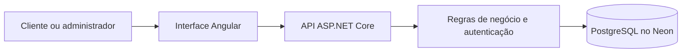
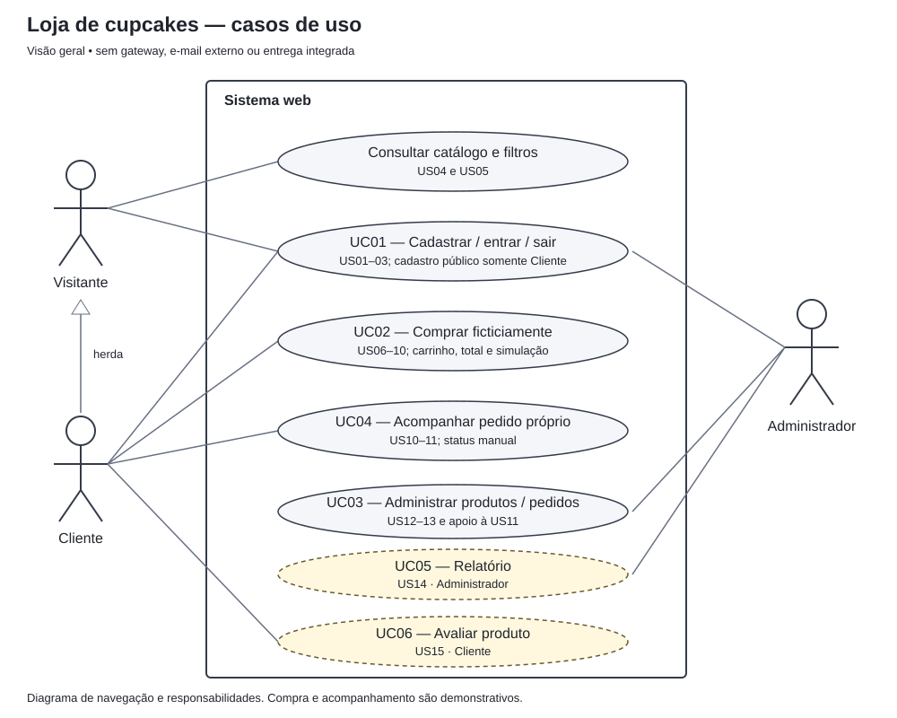
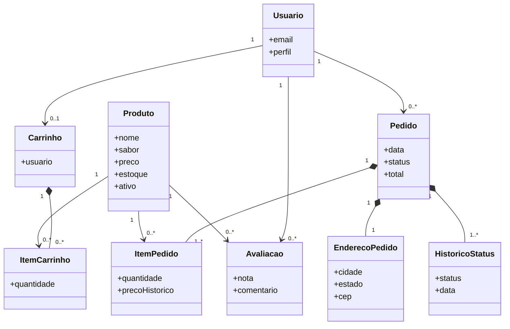
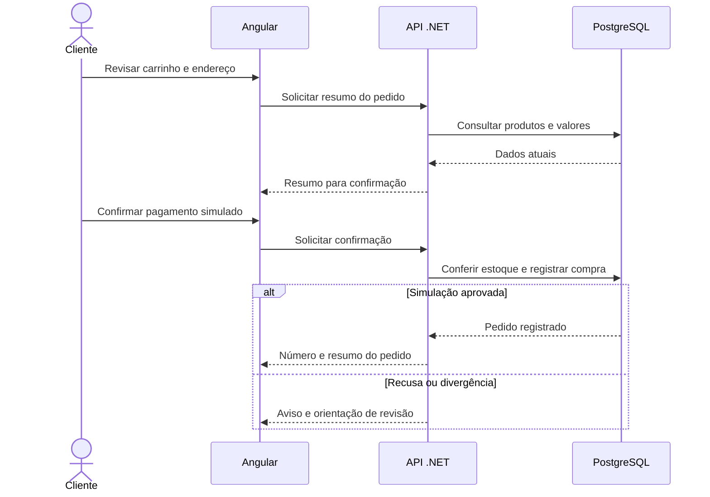
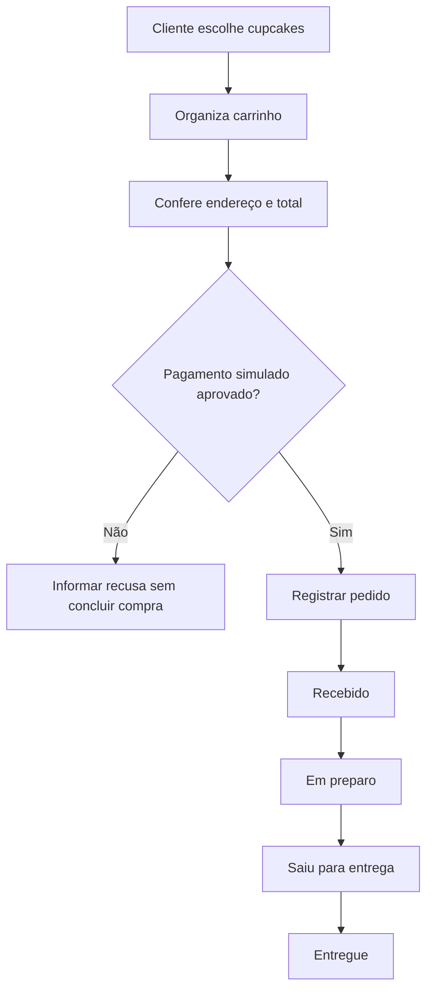

# Arquitetura e modelagem UML

## 1. Organização da aplicação

O projeto utiliza duas partes integradas. O **Angular** apresenta as páginas e recebe as ações do usuário. A **API em ASP.NET Core**, escrita em C#, aplica as regras da loja, verifica as permissões e consulta o banco de dados **PostgreSQL**. A comunicação ocorre por requisições HTTP.

A separação de responsabilidades segue o princípio discutido no material da disciplina: interface para apresentação, controladores e serviços para processar as ações e modelo de dados para representar e armazenar as informações. A aplicação não utiliza microsserviços nem um sistema de pagamentos externo.

Na publicação acadêmica, interface e API são disponibilizadas pelo Render; o banco permanece hospedado no Neon.

## 2. Casos de uso

O sistema possui três perfis: **visitante**, **cliente** e **administrador**. O visitante consulta produtos e cria uma conta; o cliente monta pedidos fictícios e acompanha compras; o administrador gerencia o catálogo e o andamento dos pedidos.

### Caso de uso 1 — Cadastro e acesso

**Ator:** visitante ou cliente.  
**Pré-condição:** acesso ao site.  
**Fluxo principal:** o visitante informa os dados de cadastro, recebe a confirmação na tela, acessa o formulário de login e entra com suas credenciais. O cliente pode sair e encerrar a sessão.  
**Exceções:** e-mail já utilizado, senha fora dos critérios ou credenciais incorretas.  
**Resultado:** conta criada e, após login válido, sessão autenticada. Não há confirmação enviada por e-mail.

### Caso de uso 2 — Realizar pedido simulado

**Ator:** cliente.  
**Pré-condição:** cliente autenticado com produtos disponíveis.  
**Fluxo principal:** o cliente consulta os produtos, adiciona itens ao carrinho, verifica os valores, informa um endereço fictício, escolhe o pagamento simulado e confirma. O sistema registra o pedido e apresenta o número de referência.  
**Exceções:** item sem estoque, preço alterado, dados inválidos, simulação recusada ou falha de comunicação.  
**Resultado:** pedido aprovado ficticiamente, com histórico registrado, sem cobrança financeira.

### Caso de uso 3 — Administrar a loja

**Ator:** administrador.  
**Pré-condição:** usuário com permissão administrativa.  
**Fluxo principal:** o administrador cadastra ou atualiza produtos, ajusta estoque, desativa itens e consulta pedidos para avançar seus status. Também pode visualizar relatórios.  
**Exceções:** dados de produto inválidos, tentativa de alteração de status fora de ordem ou acesso sem permissão.  
**Resultado:** catálogo e pedidos atualizados de acordo com as regras do sistema.

### Caso de uso 4 — Acompanhar pedido

**Ator:** cliente.  
**Pré-condição:** pedido registrado na conta.  
**Fluxo principal:** abrir "Meus pedidos", selecionar uma compra e consultar seu histórico de status.  
**Exceção:** pedido inexistente ou pertencente a outro cliente.  
**Resultado:** informações do próprio pedido apresentadas; não há rastreamento geográfico.

## 3. Diagrama de classes simplificado

As classes abaixo representam os principais dados da aplicação. Os relacionamentos e os campos físicos aparecem com mais detalhes no [modelo de dados](../dados/MODELO_DADOS.md).

## 4. Diagrama de sequência da compra

O fluxo destaca a participação do usuário, da interface, do servidor e do banco. A confirmação ocorre somente após a validação do carrinho, dos preços e da disponibilidade.

## 5. Atividades e evolução do pedido

Os estados depois de "Recebido" são atualizados manualmente pelo administrador. O diagrama representa o acompanhamento acadêmico, e não o percurso físico de uma entrega.
