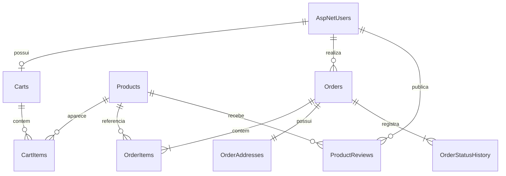

# Modelagem e organização do banco de dados

## 1. Finalidade

O banco de dados armazena as informações necessárias para manter contas, produtos, carrinhos, pedidos e avaliações. Foi utilizado **PostgreSQL**, hospedado no **Neon**, com acesso pela API em C# por meio do Entity Framework Core.

A modelagem foi feita para reduzir informações repetidas, preservar o histórico dos pedidos e garantir que usuários diferentes não compartilhem indevidamente seus dados.

## 2. Principais entidades

| Entidade | Informações armazenadas | Relação no sistema |
| --- | --- | --- |
| Usuários e perfis | E-mail, autenticação e permissões. | Um usuário pode ter carrinho, pedidos e avaliações. |
| Produtos | Nome, sabor, descrição, imagem, preço, promoção, estoque e situação ativa/inativa. | Podem estar em diferentes carrinhos, pedidos e avaliações. |
| Carrinhos | Identificação do cliente. | Um carrinho reúne os itens escolhidos antes da compra. |
| Itens do carrinho | Produto e quantidade. | Cada item pertence a um carrinho. |
| Pedidos | Cliente, data, total, resultado de pagamento simulado e status. | Um pedido possui itens, endereço e histórico de andamento. |
| Itens do pedido | Produto, quantidade, nome e preços preservados no momento da compra. | Evitam que mudanças futuras do catálogo alterem pedidos antigos. |
| Endereço do pedido | Destinatário, logradouro, número, bairro, cidade, estado e CEP. | Cada pedido mantém sua informação de destino fictício. |
| Histórico de status | Estado e data de cada atualização. | Registra o acompanhamento manual do pedido. |
| Avaliações | Autor, produto, nota e comentário. | Uma avaliação por usuário e produto, com possibilidade de edição. |

As tabelas de acesso e de perfis usam a estrutura padrão do ASP.NET Core Identity. Não existe uma tabela separada para transações bancárias reais.

## 3. Diagrama entidade-relacionamento

## 4. Dicionário de dados resumido

A tabela apresenta os campos mais importantes do modelo físico, sem reproduzir todos os campos internos utilizados pelo mecanismo de autenticação.

| Tabela | Chave ou campos principais | Tipo ou regra importante |
| --- | --- | --- |
| `AspNetUsers` | `Id`, `Email`, dados de autenticação | Identificador de usuário em texto; e-mail normalizado para evitar duplicação. |
| `Products` | `Id`, `Name`, `Flavor`, `Description`, `ImagePath`, `Price`, `PromotionalPrice`, `Stock`, `IsActive` | Identificador `uuid`; preços `numeric(12,2)`; estoque inteiro não negativo. |
| `Carts` | `Id`, `UserId` | Um carrinho associado a cada cliente. |
| `CartItems` | `CartId`, `ProductId`, `Quantity` | Par carrinho/produto identifica o item; quantidade positiva. |
| `Orders` | `Id`, `UserId`, `CreatedAt`, `Status`, `PaymentMethod`, `PaymentResult`, `Subtotal`, `Discount`, `Total` | Valores monetários decimais; data/hora; pagamento simulado. |
| `OrderItems` | `OrderId`, `ProductId`, `ProductName`, `OriginalUnitPrice`, `AppliedUnitPrice`, `Quantity` | Nome e valores históricos da compra. |
| `OrderAddresses` | `OrderId`, `Recipient`, `Street`, `Number`, `Neighborhood`, `City`, `State`, `PostalCode` | Endereço associado a um único pedido. |
| `OrderStatusHistory` | `Id`, `OrderId`, `Status`, `ChangedAt` | Registro cronológico dos status. |
| `ProductReviews` | `Id`, `UserId`, `ProductId`, `Rating`, `Comment`, `CreatedAt`, `UpdatedAt` | Nota entre 1 e 5; avaliação única por autor/produto. |

## 5. Integridade e histórico das informações

As relações utilizam chaves primárias e estrangeiras. Há restrições para impedir valores inválidos, como estoque negativo, quantidade igual a zero e nota fora da escala permitida. O acesso a pedidos e carrinhos é associado ao usuário autenticado.

Ao finalizar uma compra fictícia, o sistema registra pedido, itens, endereço e status inicial de forma coordenada. Os valores usados na compra são preservados para consulta histórica. Por esse motivo, **desativar um produto não apaga os registros de pedidos anteriores**.

O PostgreSQL é independente do serviço de hospedagem no Render. Assim, os dados do negócio não dependem dos arquivos temporários do servidor de aplicação. A validação completa de uma compra no ambiente público e da persistência após reinício permanece uma verificação recomendada antes da entrega final.
