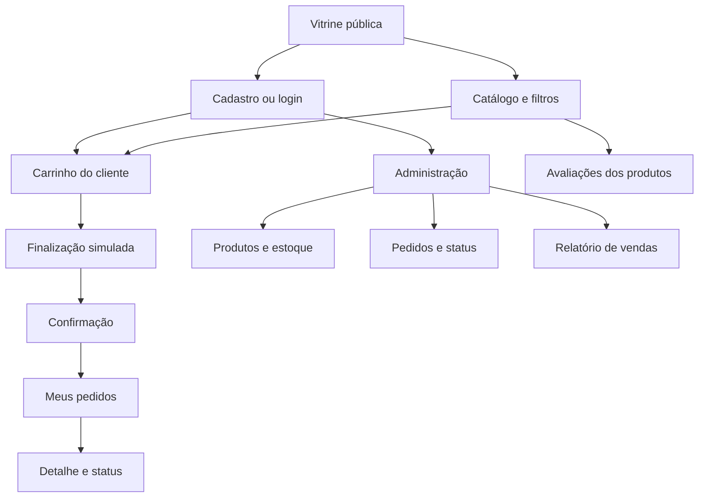
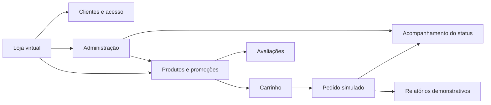
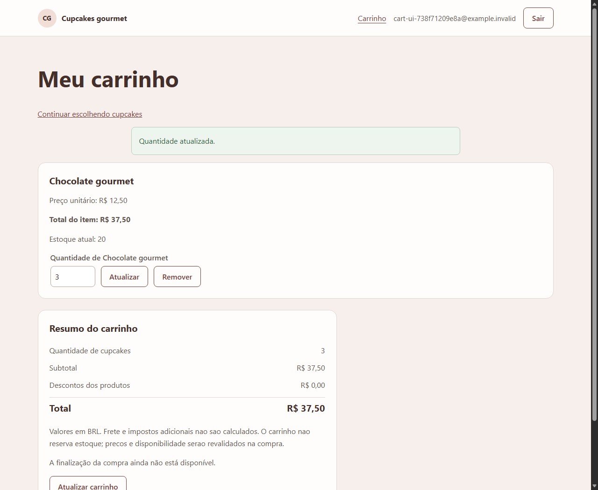
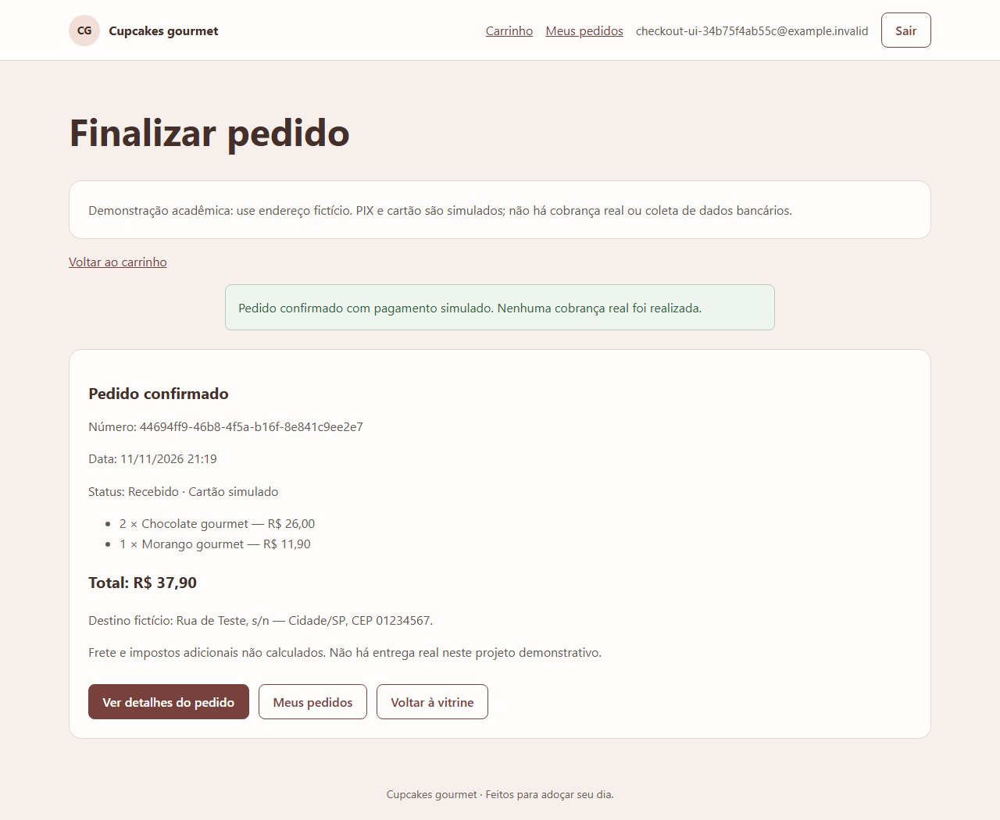
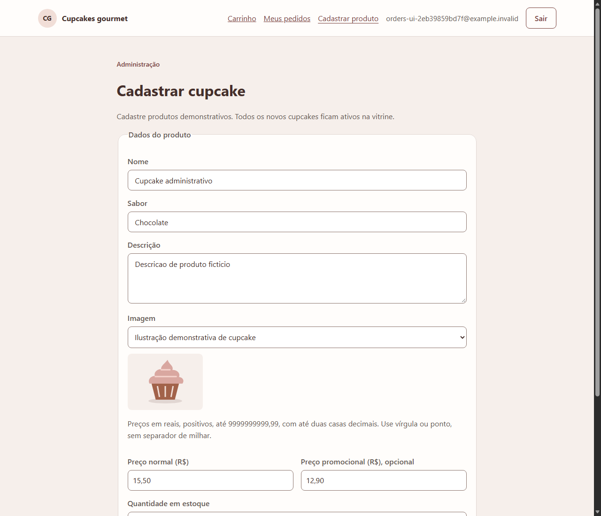
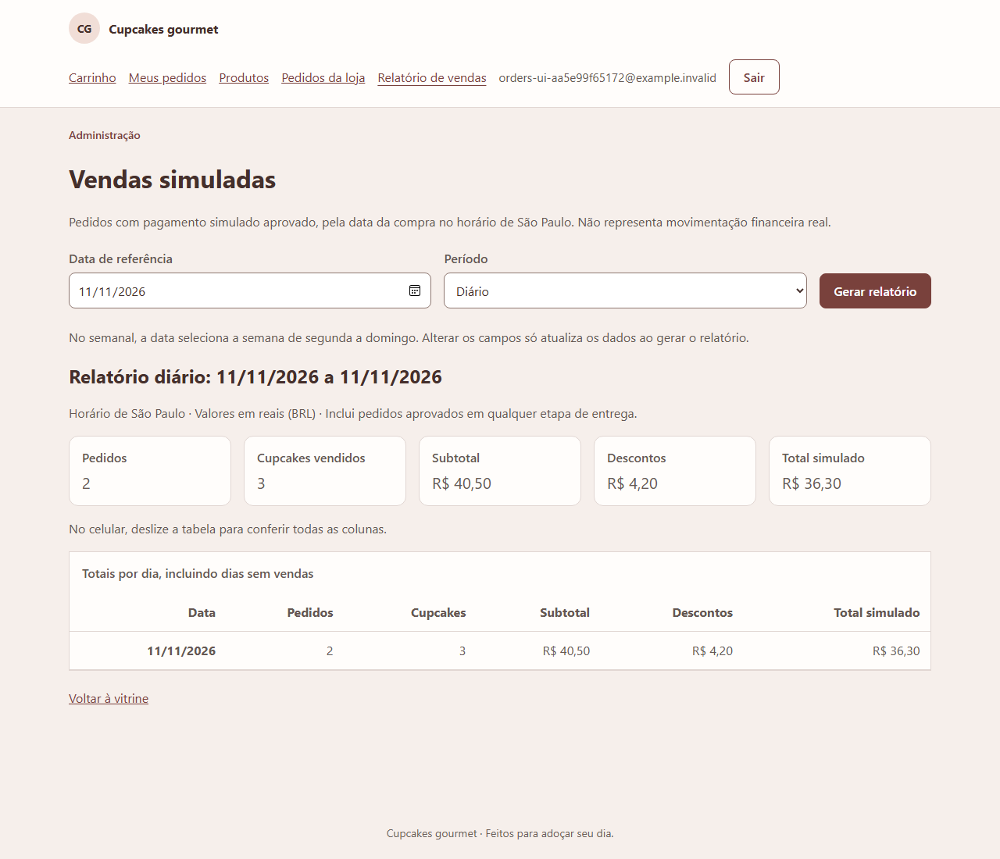

# Interface, navegação e usabilidade

## 1. Proposta da interface

A loja foi concebida para oferecer uma navegação simples, com destaque para os produtos, seus preços e o acesso ao carrinho. O visual utiliza cartões de produtos, textos diretos e mensagens para informar resultados de ações ou possíveis erros.

A solução é **web responsiva**: as páginas se adaptam a computadores e celulares, sem exigir um aplicativo instalado. Há áreas diferentes para visitantes, clientes e administradores.

## 2. Mapa navegacional

## 3. Mapa conceitual

## 4. Telas do sistema

| Tela | Finalidade |
| --- | --- |
| Vitrine | Apresentar cupcakes ativos, preços, promoções e disponibilidade. |
| Cadastro e login | Permitir acesso de clientes com mensagens de validação. |
| Carrinho | Revisar itens, quantidades e valores antes da compra. |
| Finalização | Informar endereço fictício, revisar total e escolher pagamento simulado. |
| Confirmação e pedidos | Exibir pedido registrado, número de referência, histórico e status. |
| Administração de produtos | Cadastrar, editar, consultar estoque e desativar produtos. |
| Administração de pedidos | Consultar pedidos e atualizar status. |
| Relatório | Consultar vendas simuladas por período e exportar os dados. |
| Avaliações | Ler e registrar nota e comentário sobre cupcakes. |

Os [wireframes do planejamento](WIREFRAMES.html) mostram a organização prevista para as telas. Eles são desenhos estáticos; as imagens abaixo ilustram telas executadas durante testes locais da aplicação.

## 5. Exemplos visuais

**Carrinho em uso** — os itens são organizados antes de avançar para a compra.

**Confirmação de pedido fictício** — a aplicação apresenta a referência, o total e o aviso de que não houve cobrança real.

**Administração** — o gerenciamento de produtos e pedidos é restrito aos administradores.

**Relatório demonstrativo** — os resultados representam vendas simuladas.

## 6. Cuidados de usabilidade

Foram considerados textos legíveis, mensagens próximas aos formulários, indicações de carregamento, tratamento de listas vazias, navegação por teclado, identificação visual do foco e organização das telas para diferentes larguras. Registros de teste incluem verificações em larguras de **360 px e 1280 px**, além de uma revisão básica de rótulos e foco.

Essas verificações representam uma amostra técnica de usabilidade; não substituem a avaliação real dos cinco participantes nem uma auditoria completa de acessibilidade.
