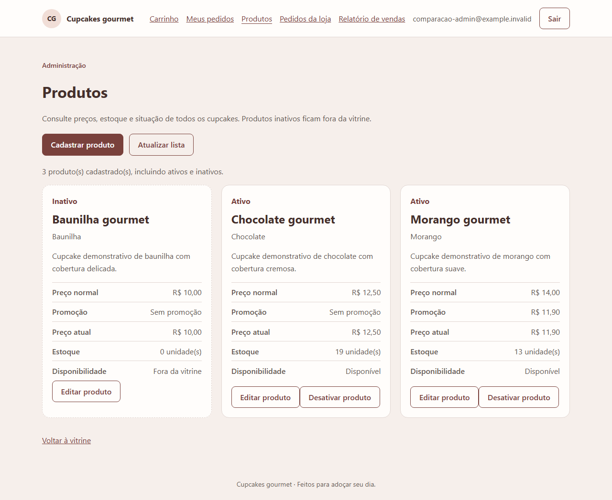
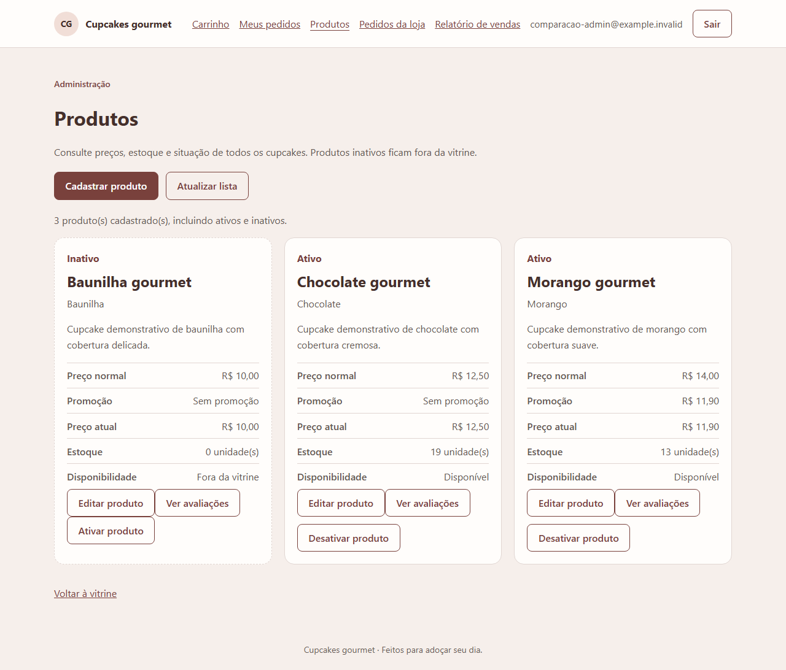
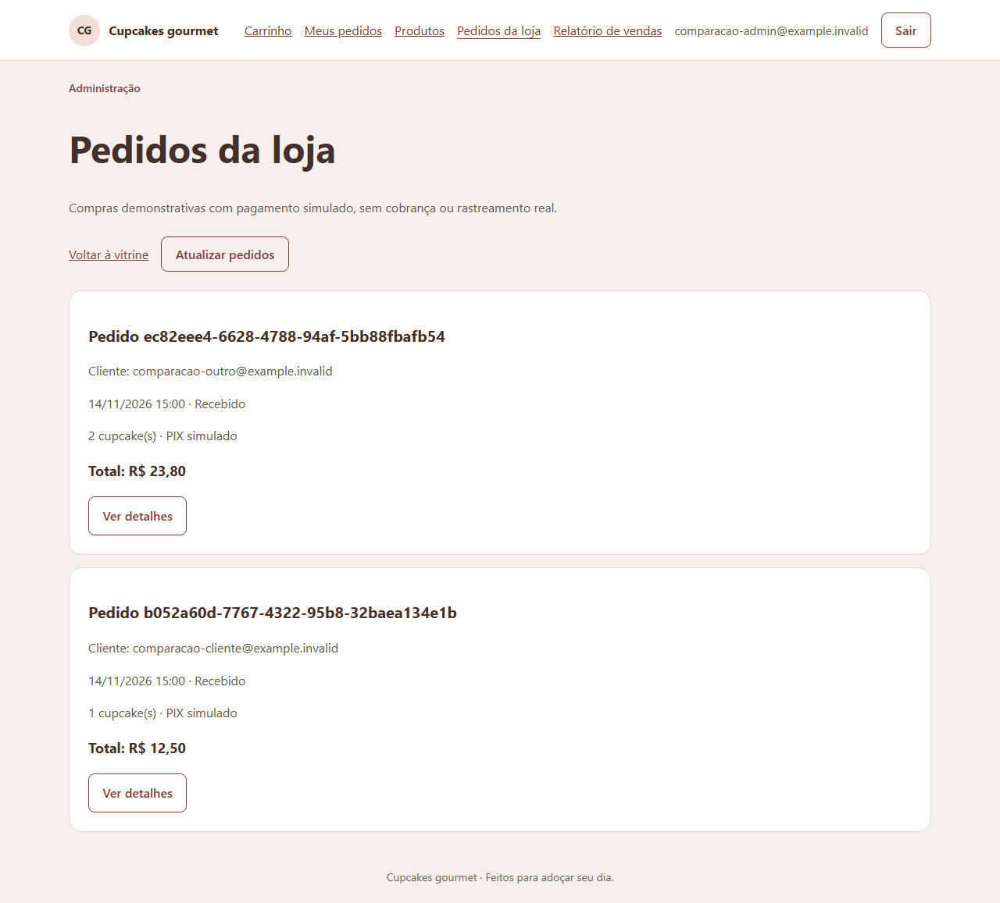
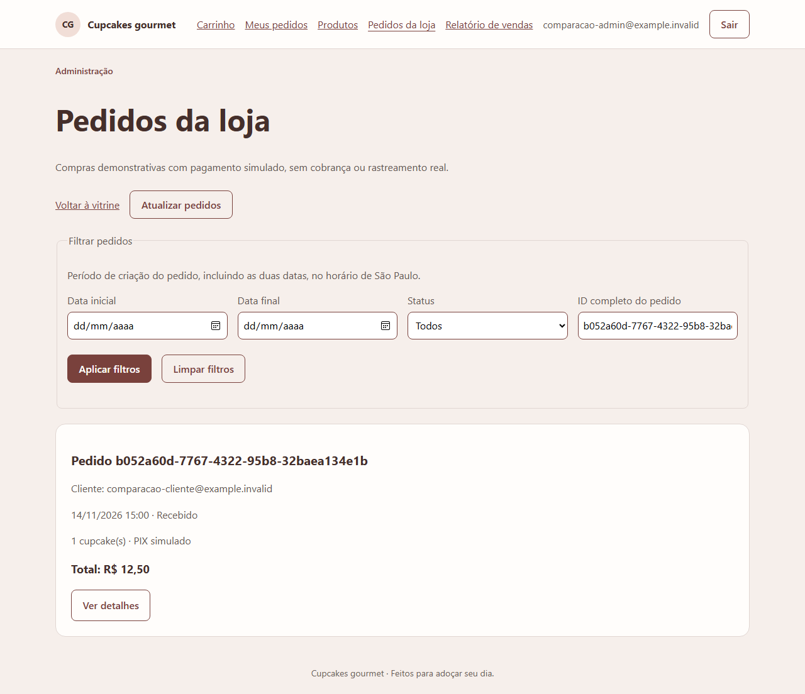
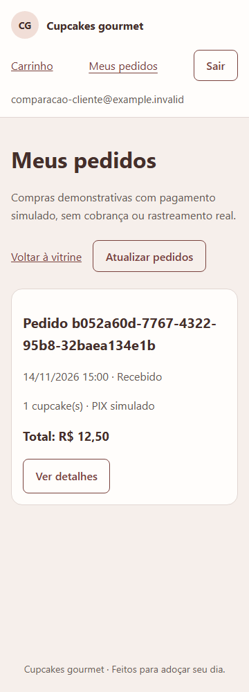
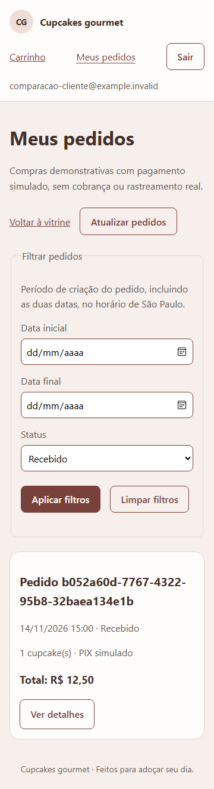
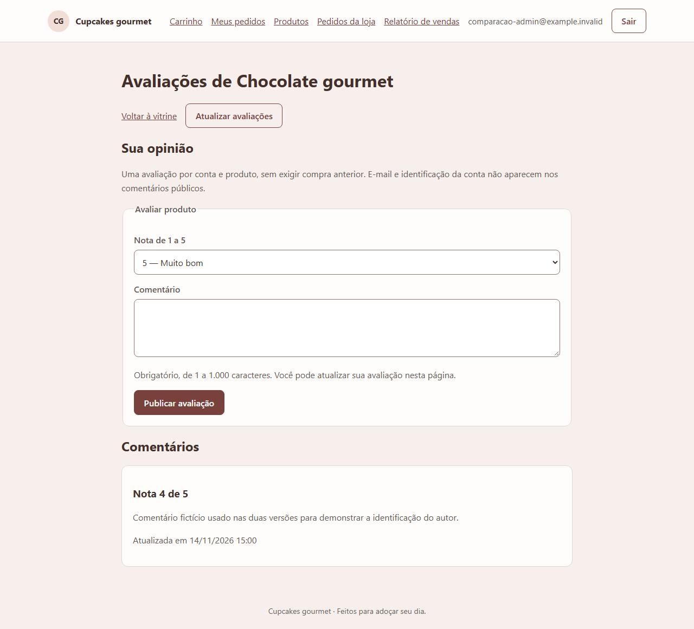
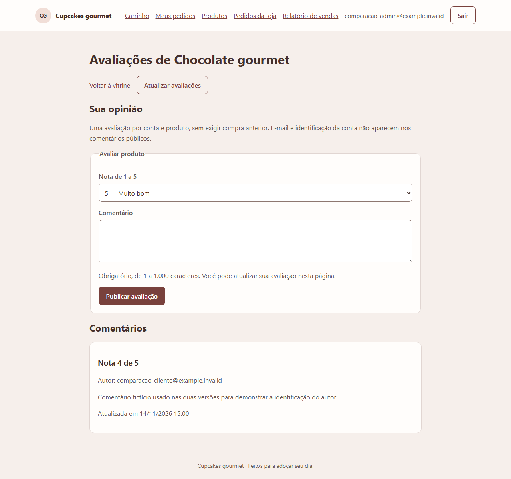

# Laudo de qualidade — Loja de Cupcakes Gourmet

**Registro:** 14/11/2026. **Objeto:** aplicação acadêmica Angular/ASP.NET Core/PostgreSQL, com pagamentos e entregas simulados. **Endereço:** https://cupcakes-gourmet-aaxi.onrender.com.

## 1. Fontes e condições

Este laudo reúne os cinco relatos enviados pelo estudante e os testes técnicos efetivamente executados. Os testes dos participantes não foram acompanhados diretamente pelo assistente. Não foram informados navegador, aparelho, duração ou roteiro individual; esses dados não são presumidos. Os relatos não comprovam todas as regras de negócio ou ausência de defeitos.

As avaliações fictícias inseridas nas páginas dos produtos são exclusivamente dados de demonstração e **não integram esta amostra de cinco participantes**. Seus horários são datas artificiais de cenário, não horários de execução dos testes humanos.

## 2. Relatos fornecidos pelo estudante

| Participante | Data informada | O que funcionou segundo o relato | Melhoria solicitada / função ausente |
| --- | --- | --- | --- |
| Lucas Buchner | 13/11/2026 | Administração: gerenciamento de produtos, visualização de pedidos, relatórios e alteração de status. | Não relatou erro de execução; faltou reabilitar produtos desativados. |
| Gabryel Gimenez | 14/11/2026 | Administração: gerenciamento de produtos, visualização de pedidos, relatórios e alteração de status. | Não relatou erro de execução; pediu filtros de pedidos por data, status e ID. |
| Tobias Gavloski | 14/11/2026 | Cliente: visualização de produtos, carrinho, realização de pedido e avaliações. | Informou funcionamento dos testes realizados; pediu filtros dos próprios pedidos por status e data. |
| Leonardo Maros | 14/11/2026 | Cliente: visualização de produtos, carrinho, realização de pedido e avaliações. | Informou funcionamento dos testes realizados; também pediu filtros por status e data. |
| Pedro Magalhães | 14/11/2026 | Administração: gerenciamento de produtos, visualização de pedidos, relatórios e alteração de status. | Não relatou erro de execução; pediu identificação de quem escreveu cada avaliação, somente para administradores. |

O campo original de funcionalidades não testadas/ausentes foi usado pelos participantes para apontar as mesmas funções faltantes. Não há detalhamento suficiente para declarar quais outras funcionalidades cada pessoa deixou de testar. Os apontamentos acima foram tratados como melhorias de funcionalidade e usabilidade, sem inventar falhas de execução que os participantes não relataram.

## 3. Tratamento dos apontamentos

| Apontamento | Tratamento implementado | Situação da validação |
| --- | --- | --- |
| Reativação de produtos | Botão Ativar produto nos itens inativos; preserva estoque, preços e histórico. | Testado e validado. |
| Filtros administrativos | Período de criação, status e ID completo, combináveis; limpar filtros; mensagem de resultado vazio. | Testado e validado. |
| Filtros do cliente | Período e status somente sobre pedidos da conta autenticada. | Testado e validado. |
| Autor das avaliações | E-mail atual do autor na visualização administrativa, inclusive para produtos desativados; visitantes/clientes não recebem essa identificação. | Testado e validado. |

## 4. Evidências técnicas de 14/11/2026

- **358 testes de API aprovados**, zero falhas/ignorados, no PostgreSQL local exclusivo de testes. Cobertura adicional de limites de data em São Paulo, combinação dos filtros, isolamento dos clientes e identificação administrativa dos autores sem vazamento no contrato público.
- **217 testes Angular aprovados**, além de build de produção aprovado. Contagens representam a suíte atual, não a soma de avaliações humanas.
- **Navegador Microsoft Edge headless**, com Angular/API e banco temporário: filtros administrativos combinados, limpeza e troca de status; filtro e resultado vazio do cliente; autor correto para administrador e ausência da identificação após sair/trocar de conta. Layout conferido em 1280 px e 360 px, sem rolagem horizontal.
- O banco temporário do teste de navegador foi removido ao concluir.

### 4.1. Origem das capturas de antes e depois

As oito capturas abaixo foram produzidas em **14/11/2026**, executando interfaces reais do repositório em ambiente local isolado, no Microsoft Edge, com as mesmas contas, produtos, pedidos e comentário fictícios. São reproduções técnicas das versões, **não capturas feitas durante as sessões dos cinco participantes**. Não foram removidos elementos da tela para simular o antes.

- **Antes dos filtros e da identificação do autor:** interface do commit `83eba48`.
- **Antes da reativação:** interface do commit `c40e9e7`.
- **Depois:** interface do commit `3cb0625`, que inclui as melhorias.

As interfaces utilizaram a API atual compatível e a mesma base PostgreSQL temporária. A base foi removida ao concluir. O Render, o Neon e o container local de uso não foram modificados. As capturas de computador usam largura de 1280 px; as de cliente em celular usam 360 px. As imagens mostram a página completa e podem ter alturas diferentes conforme o conteúdo.

### 4.2. Reativação de produtos — apontamento de Lucas

**Antes:** o item inativo permitia edição, mas não oferecia reativação. **Depois:** passou a oferecer **Ativar produto**. O mesmo produto foi mantido inativo nas duas capturas para destacar a disponibilidade do botão.

| Antes — `c40e9e7` | Depois — `3cb0625` |
| --- | --- |
|  |  |

### 4.3. Filtros administrativos de pedidos — apontamento de Gabryel

**Antes:** a lista mostrava todos os pedidos, sem formulário de filtros. **Depois:** permite período, status e ID completo; a captura mostra o filtro de ID aplicado, retornando o pedido escolhido da mesma base de dados.

| Antes — `83eba48` | Depois — `3cb0625` |
| --- | --- |
|  |  |

### 4.4. Filtros dos pedidos do cliente — apontamentos de Tobias e Leonardo

**Antes:** o cliente consultava seus pedidos sem filtros. **Depois:** pode filtrar por período e status. A comparação em largura mobile mostra a mesma conta e o mesmo pedido, com o status **Recebido** selecionado no depois.

| Antes — `83eba48` | Depois — `3cb0625` |
| --- | --- |
|  |  |

### 4.5. Identificação administrativa do autor — apontamento de Pedro

**Antes:** mesmo autenticado como administrador, o usuário via nota, comentário e data, sem identificação do autor. **Depois:** o mesmo comentário também mostra o e-mail do autor para o administrador. A identificação permanece ausente para visitantes e clientes, conforme os testes técnicos registrados.

| Antes — `83eba48` | Depois — `3cb0625` |
| --- | --- |
|  |  |

Os relatórios detalhados da captura e os fontes exportados ficam no contexto interno ignorado pelo Git. As imagens não contêm senhas e utilizam somente contas fictícias de comparação.

## 5. Conclusão e pendências

Os cinco relatos indicam funcionamento satisfatório das funções que seus autores afirmaram testar e identificam oportunidades de melhoria na administração do catálogo, consulta de pedidos e identificação de avaliações. Os aprimoramentos foram implementados e tiveram validação técnica favorável.

Após as melhorias, o estudante informou que tudo foi testado e aprovado. Esse aceite é do estudante; não equivale a declarar um novo reteste individual dos cinco participantes.
