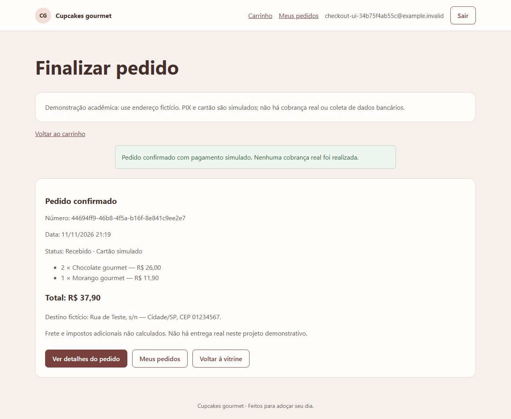
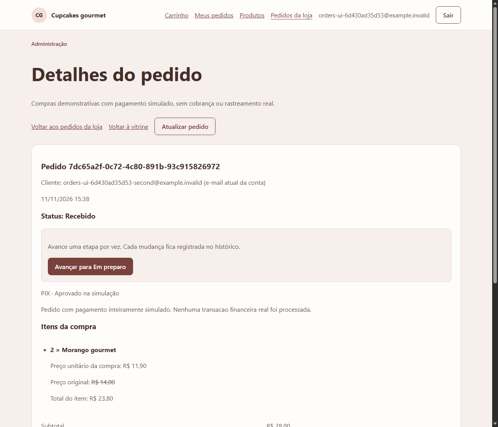

# Testes realizados e acompanhamento da qualidade

## 1. Objetivo

Os testes foram utilizados para conferir se as funções da loja apresentam o comportamento esperado e se as informações são mantidas corretamente. Há registros de validação automática da API e do Angular, testes em navegador e verificações da publicação. **Esses resultados técnicos não substituem os testes solicitados a cinco colegas ou profissionais da área.**

As informações a seguir foram consolidadas a partir dos relatórios produzidos durante o desenvolvimento. Não representam uma nova execução feita na data desta síntese.

## 2. Resultados técnicos registrados

| Verificação | Resultado registrado | Alcance |
| --- | --- | --- |
| Testes da API e regras de negócio | **339 testes aprovados** na revisão integrada de 11/11/2026. | Cadastro, autorização, carrinho, pedido, banco, estoque e regras administrativas, entre outros cenários. |
| Testes do Angular | **203 testes aprovados** na revisão de usabilidade de 11/11/2026. | Componentes e comportamentos da interface; não equivale a avaliação humana. |
| Fluxo de compra em navegador local | Realizado com Angular, API e PostgreSQL de teste. | Carrinho, valores, endereço, recusa, aprovação, consulta do pedido e acesso isolado por usuário. |
| Usabilidade básica | Roteiros registrados em navegador, incluindo 360 px e 1280 px. | Teclado, foco, rótulos, mensagens e adaptação de algumas telas. |
| Publicação no Render/Neon | Em 13/11/2026, o relatório registra **23 verificações HTTPS** e **6 verificações em navegador** aprovadas. | Acesso à vitrine, login administrativo, APIs, arquivos publicados e navegação principal. |

As contagens acima correspondem a conjuntos distintos de testes. Resultados intermediários do desenvolvimento não devem ser somados como se fossem novas avaliações.

## 3. Exemplos de testes de integração

| Situação testada | Resultado registrado |
| --- | --- |
| Cadastro e login | Conta de teste criada e acesso realizado pela interface integrada à API. |
| Carrinho e total | Inclusão, alteração, remoção e atualização dos valores verificadas. |
| Pagamento simulado recusado | Sem pedido aprovado e sem redução de estoque; carrinho mantido. |
| Mudança de preço antes de confirmar | Aplicação solicita revisão do novo total. |
| Pagamento simulado aprovado | Pedido criado uma única vez, estoque atualizado e carrinho esvaziado no banco de teste. |
| Consulta de pedidos | Cliente visualiza os próprios pedidos, sem acesso ao pedido de outra conta de teste. |
| Atualização administrativa | Alterações de produtos/status aparecem nas consultas respectivas, conforme relatórios por funcionalidade. |

Exemplo de evidência da compra fictícia:

Exemplo de acompanhamento administrativo:

## 4. Ajustes identificados durante a revisão técnica

Na revisão de navegação por teclado, foi observado que o foco nem sempre acompanhava corretamente a mudança de página. O tratamento foi ajustado e o roteiro repetido com resultado favorável. Também foi incorporado um atalho de teclado para avançar ao conteúdo principal.

Esse ajuste é uma correção técnica registrada durante o desenvolvimento, **não uma reclamação de participante**. O documento final de qualidade deverá separar falhas descobertas pela equipe dos apontamentos recebidos nos cinco testes externos.

## 5. Limitações e verificações pendentes

- A versão acadêmica não envia e-mails, não realiza pagamentos reais e não rastreia entregadores.
- As metas de desempenho em segundos do planejamento original não foram medidas de forma conclusiva.
- Os arquivos PDF de relatório foram verificados programaticamente, mas a apresentação visual ainda requer conferência; os rótulos registrados não utilizam todos os acentos.
- A publicação foi conferida em acessos e fluxos selecionados. O relatório de 13/11/2026 não registra compra pública completa ou persistência após reinício do serviço.
- Não há relato documentado dos cinco avaliadores nem comprovação de correções decorrentes desses feedbacks.
- Os vídeos exigidos no formulário de entrega ainda precisam ser gravados.

## 6. Testes com cinco avaliadores — a preencher após a realização

O formulário da disciplina pede, para cada pessoa, **nome, data, o que funcionou, o que não funcionou e funcionalidades não testadas**. Recomenda-se fornecer o link publicado e solicitar que cada participante execute ações como consultar catálogo, cadastrar-se, montar carrinho, finalizar compra simulada e consultar pedidos.

| Participante | Data | Funcionou | Problemas e correções sugeridas | Não testado e motivo |
| --- | --- | --- | --- | --- |
| 1 — a preencher | — | — | — | — |
| 2 — a preencher | — | — | — | — |
| 3 — a preencher | — | — | — | — |
| 4 — a preencher | — | — | — | — |
| 5 — a preencher | — | — | — | — |

Preencher somente após os testes reais. Capturas devem registrar defeitos encontrados ou mostrar o resultado das correções, quando pertinente. As cinco opiniões deverão ser reunidas conforme a orientação acadêmica.

## 7. Estrutura sugerida para o laudo final

O laudo de qualidade não deve ser encerrado antes de avaliar os cinco registros. Ao final, incluir:

1. **Objeto avaliado:** loja virtual acadêmica e versão disponibilizada.
2. **Condições:** data, ambiente e funções testadas.
3. **Resultados:** funcionamento confirmado e problemas observados.
4. **Tratamento dos problemas:** correções aplicadas ou justificativa de não aplicação.
5. **Evidências:** imagens de telas e registros correspondentes.
6. **Conclusão:** situação da versão após as correções, com as limitações restantes.

Para a entrega, também são pedidos um vídeo narrado de demonstração com **pelo menos cinco minutos** e outro de até **cinco minutos** apresentando as alterações posteriores aos feedbacks. Os links devem ser inseridos no documento acadêmico somente após os vídeos existirem.
